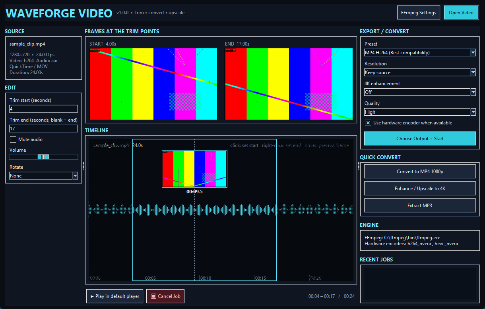

# WaveForge Video

A small Windows desktop app for trimming, converting, rotating and upscaling video. It is a friendly front-end for [FFmpeg](https://ffmpeg.org): you pick a clip, set the range you want, choose a format, and it does the work.



## Features

- **Open almost anything** FFmpeg can read (MP4, MKV, MOV, AVI, WebM, TS, WMV, FLV, MP3, WAV, FLAC and more). File details and a real audio waveform are shown on a timeline.
- **Trim** by typing start/end seconds, or click the timeline to set the start and right-click to set the end.
- **See what you are cutting**: still frames at the start and end points, and a thumbnail that follows your mouse along the timeline.
- **Convert** to MP4 (H.264 or H.265), MOV (H.264), WebM (VP9), or extract audio as MP3 or FLAC.
- **Resize** to 720p, 1080p, 1440p or 4K (letterboxed to keep the aspect ratio), with optional Lanczos upscaling, sharpening and denoising.
- **Rotate** 90° either way or 180°, **mute** or change the **volume**.
- **GPU encoding** with NVIDIA NVENC, Intel Quick Sync or AMD AMF. Each encoder is test-encoded at startup, and an export that fails on the GPU is retried automatically with the software encoder.
- **Safe exports**: output is written to a temporary `.part` file and only moved into place when it finishes, so a failed or cancelled export never leaves a broken file or damages an existing one. You cannot overwrite your source clip by accident.
- A progress bar, cancel button and a log of every export.

## Install

### Windows (no Python needed)

1. Download `WaveForgeVideo-<version>-windows.zip` from the [Releases](../../releases) page and unzip it.
2. Install FFmpeg (see below).
3. Run `WaveForgeVideo.exe`.

### From source

Needs Python 3.10 or newer with Tk (included in the standard Windows installer). There are no pip dependencies.

```bash
python waveforge_video.py
```

or double-click `start_waveforge_video.bat`.

### FFmpeg

WaveForge Video does not include FFmpeg; install it separately. The easiest way on Windows:

```bash
winget install Gyan.FFmpeg
```

The app looks for `ffmpeg.exe` and `ffprobe.exe` in this order: the path set under **FFmpeg Settings**, next to the app (or in a `bin` folder beside it), your `PATH`, the WinGet install folder, and `C:\ffmpeg\bin`. If it cannot find them, the ENGINE panel says so.

## Using it

1. **Open Video**, pick a file.
2. Set the range to keep (leave *Trim end* blank to go to the end).
3. Choose a preset, resolution and quality, then **Choose Output + Start**. The **Quick Convert** buttons are shortcuts for common jobs.

More detail is in the [user guide](docs/USER_GUIDE.md); if something goes wrong see [troubleshooting](docs/TROUBLESHOOTING.md).

Settings and export logs are stored in `%APPDATA%\WaveForgeVideo`. Set the `WAVEFORGE_HOME` environment variable to keep them somewhere else, for example next to a portable copy.

## Limitations

- It works on one clip at a time: there is no multi-clip timeline, cutting out the middle of a clip, transitions, titles or colour grading.
- There is no built-in video player: the previews are still frames. *Play in default player* opens the original file in your system player.
- Trimming re-encodes the video, so it is not instant and not lossless.
- Developed and tested on Windows 11. It uses only Tk and Python's standard library, so it may run on Linux or macOS, but that has not been tried.

## Development

```bash
python -m pip install -r requirements-dev.txt
python -m pytest
```

The tests that run real exports need FFmpeg installed and are skipped when it is missing. `build_exe.bat` builds the Windows executable with PyInstaller into `dist\WaveForgeVideo`. See [CONTRIBUTING.md](CONTRIBUTING.md).

## License

[MIT](LICENSE). FFmpeg is a separate program with its own license terms.
